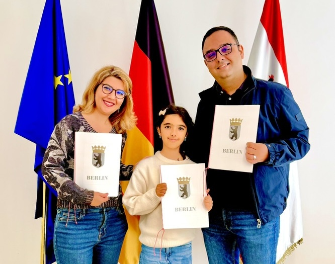

After nearly six years of living in Germany, my family and I are becoming German citizens.

This is probably one of the biggest milestones in our lives since moving to Germany. It's a special feeling to be able
to call Germany home.

Many people seek German citizenship because it gives them greater freedom to travel. With a German passport, you can
visit many countries without needing a visa. However, becoming German means much more to me than that.

Since I was a child, I've always seen Germany as a _special_ country. I was fascinated by how many good things were
**Made in Germany**. Now, being part of this society means that I should do my best to build things that are made _the
German way_.

Another thing that is special for us is that, coming from a country without a democratic system, being able to vote is
also very important to me. It's not that we couldn't vote before, but now I feel that our votes will truly be
_considered and counted_.

Becoming a citizen is not just about being part of a country. It's also about taking responsibility for the society you
want to live in.
