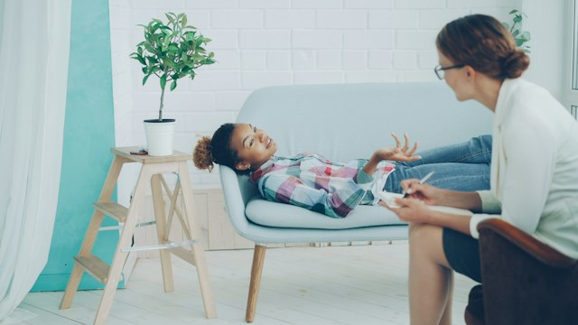

 <em><small>Photo by
<a href="https://unsplash.com/@silverkblack?utm_source=unsplash&utm_medium=referral&utm_content=creditCopyText">Vitaly
Gariev</a> on
<a href="https://unsplash.com/photos/a-young-girl-talks-to-a-therapist-on-a-couch-ObIW_W6jnXg?utm_source=unsplash&utm_medium=referral&utm_content=creditCopyText">Unsplash</a></small></em>

The other day, I was in a hybrid meeting where most people were physically present in the office and only one person was
joining remotely. During the meeting, I noticed that some people seemed hesitant to express their honest opinions. Then,
a colleague sitting next to me pointed to their laptop screen, where a message read: "Some people can't speak up because
AI note-taking is active and transcribing the entire conversation."

As soon as I noticed this, I asked the organiser to turn it off.

These days, with AI becoming part of our daily lives, automatic note-taking is becoming increasingly popular. People
enable it in _all_ their meetings, and I know their intentions are usually good. After all, let's be honest: very few
people can take notes as effectively as AI can.

But please, make sure you don't do this in 1-1s and other private meetings!

One of the most important responsibilities we have as leaders is to provide a safe and confidential space where people
feel comfortable expressing their ideas, concerns, and feelings.

Automatic note-taking is incredibly useful, but not every conversation needs to be documented. In 1-1s, trust and
openness matter more than having a perfect transcript. If you insist on recording and transcribing these conversations
without considering how the other person feels about it, you risk undermining the very trust you're trying to build.

All in all, psychological safety is more important than meeting efficiency.
